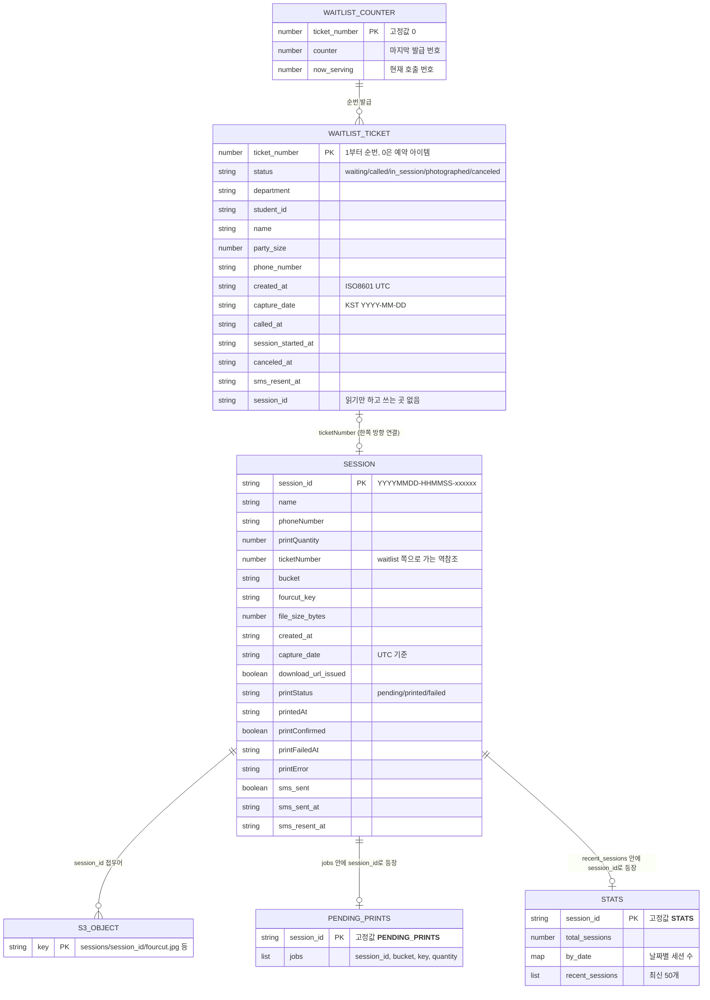
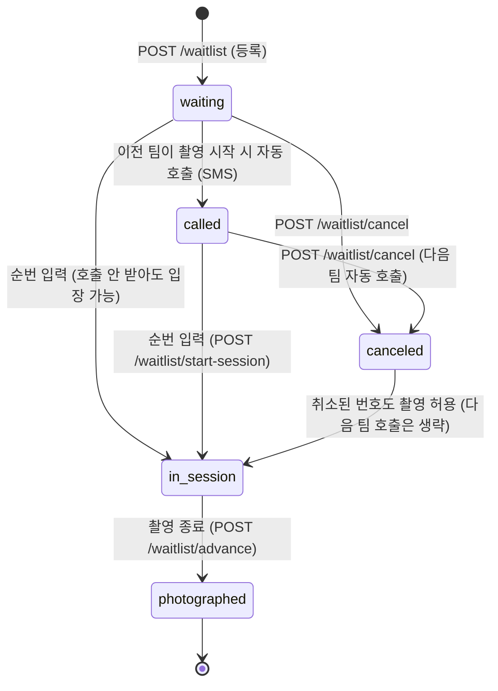
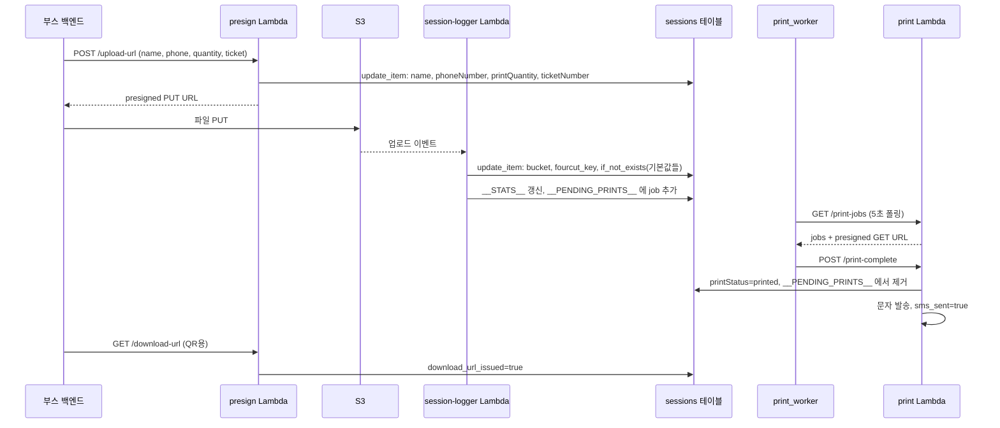
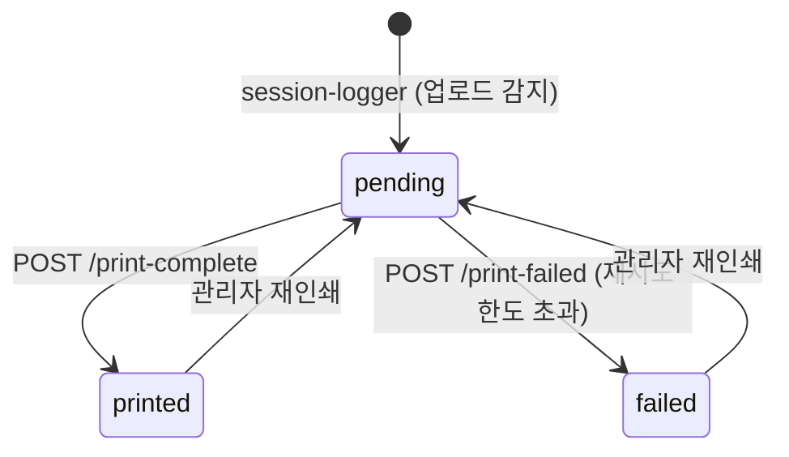

# Pik-Cha! DB 구조

> Lambda 5개 소스(`Lambda/*.py`)와 `camera/aws_uploader.py`, `camera/image_manager.py`를 읽고 정리한 문서.
> 코드에서 확인한 내용만 적었고, AWS 콘솔 설정(인덱스, TTL, S3 이벤트 필터 등)은 저장소 밖이라 확인하지 못했다.
> 해당되는 곳에는 "콘솔 확인 필요"라고 표시했다.

---

## 1. 전체 구성

저장소는 DynamoDB 테이블 2개, S3 버킷 2개, 부스 PC 로컬 파일 1개로 이루어진다.

| 저장소 | 이름 (기본값) | 파티션 키 | 용도 |
|---|---|---|---|
| DynamoDB | `sgu-pikcha-photobooth-sessions` | `session_id` (String) | 촬영 세션, 인쇄 대기열, 통계 |
| DynamoDB | `sgu-pikcha-waitinglist` | `ticket_number` (Number) | 웨이팅 티켓, 발급 카운터 |
| S3 | 사진 버킷 (`S3_BUCKET_NAME` 환경변수) | `sessions/{session_id}/{파일명}` | 컷 사진, 합성본 |
| S3 | `sgu-pikcha-admin` | 정적 호스팅 | 웨이팅·관리자 페이지 (DB 아님) |
| 로컬 파일 | `camera/images/metadata.json` | `id` | 부스 PC의 촬영 원본 메타 (AWS와 무관) |

- 테이블 이름은 환경변수 `DYNAMODB_TABLE_NAME`, `WAITLIST_TABLE_NAME`, `SESSIONS_TABLE_NAME`으로 바꿀 수 있다.
- 두 테이블 모두 키는 파티션 키 하나뿐이다. 정렬 키와 GSI는 코드에 나오지 않는다.
- 이 때문에 조건 조회(`status`가 `waiting`인 팀 등)는 전부 `scan` + `FilterExpression`으로 한다. 행사 규모에서는 문제없지만 데이터가 커지면 GSI가 필요하다.

---

## 2. 전체 관계도 (ER)



> 실선은 코드에서 실제로 값이 이어지는 관계이고, `WAITLIST_TICKET ↔ SESSION`은 한쪽 방향만 연결돼 있다. 자세한 내용은 5장 참고.
> 두 번째 줄의 `WAITLIST_COUNTER`와 `PENDING_PRINTS`, `STATS`는 별도 테이블이 아니라 **같은 테이블 안의 예약 키 아이템**이다. 그림에서는 역할을 구분하려고 따로 그렸다.

---

## 3. 테이블 1: `sgu-pikcha-waitinglist` (웨이팅)

코드: `Lambda/sgu-pikcha-waitlist.py`. 읽는 쪽은 `sgu-pikcha-admin.py`도 있다.

### 3-1. 티켓 아이템 (`ticket_number` ≥ 1)

| 속성 | 타입 | 기록 시점 | 설명 |
|---|---|---|---|
| `ticket_number` | Number (PK) | 등록 | 카운터에서 받은 순번 |
| `status` | String | 등록, 이후 전이 | 아래 상태 머신 참고 |
| `department` | String | 등록 | 학과 |
| `student_id` | String | 등록 | 학번 |
| `name` | String | 등록 | 이름 |
| `party_size` | Number | 등록 | 인원 (1 이상) |
| `phone_number` | String | 등록 | 문자 발송 대상 |
| `created_at` | String | 등록 | ISO8601, UTC |
| `capture_date` | String | 등록 | 등록일, **KST** 기준 `YYYY-MM-DD` |
| `called_at` | String | 호출 | `called`로 바뀐 시각 |
| `session_started_at` | String | 순번 입력 | `in_session`으로 바뀐 시각 |
| `canceled_at` | String | 취소 | 취소 시각 |
| `sms_resent_at` | String | 관리자 재발송 | 호출 문자 재발송 시각 |
| `session_id` | String | **어디서도 기록 안 함** | `GET /waitlist/{n}`이 읽기만 함 (5장 참고) |

### 3-2. 예약 아이템 (`ticket_number` = 0)

| 속성 | 타입 | 설명 |
|---|---|---|
| `counter` | Number | 마지막으로 발급한 번호. `SET counter = if_not_exists(counter, 0) + 1`로 원자적 증가 |
| `now_serving` | Number | 현재 호출된 번호. 대기 팀이 없으면 `0` |

- 번호 발급 중간에 실패하면 번호가 하나 비는 일은 있어도 중복은 생기지 않는다.
- 번호는 행사 전체에서 이어지고 날짜별로 초기화되지 않는다.
- 티켓을 조회하는 모든 `scan`은 `ticket_number > 0` 조건으로 이 아이템을 제외한다.

### 3-3. 상태 머신 (`status`)



코드에서 확인한 규칙은 다음과 같다.
- **다음 팀 호출 시점**은 촬영이 끝날 때가 아니라 **촬영이 시작될 때**(`start-session`)다. 다음 팀이 미리 부스로 이동할 시간을 벌기 위해서다. `/waitlist/advance`는 이제 `photographed` 표시만 한다.
- `start-session`의 `waiting/called/canceled → in_session` 전환은 `ConditionExpression`으로 한 번만 성공한다. 같은 번호를 다시 입력해도 다음 팀이 중복 호출되지 않는다.
- 한 번에 `called` 상태인 팀은 최대 1팀이다. 이미 호출된 팀이 있으면 추가 호출을 건너뛴다.
- `completed` 상태는 `start-session`에서 거부 대상으로 검사하지만, **어느 코드도 이 값을 기록하지 않는다.** 실제 종착 상태는 `photographed`다.
- 취소는 `waiting`, `called`일 때만 가능하다.

---

## 4. 테이블 2: `sgu-pikcha-photobooth-sessions` (촬영 세션)

이 테이블에는 일반 세션 아이템과 예약 키 아이템 2개가 같이 들어 있다.

### 4-1. 세션 아이템 (`session_id` = `YYYYMMDD-HHMMSS-xxxxxx`)

`session_id`는 부스 백엔드가 만든다(`aws_uploader.make_session_id`: UTC 타임스탬프 + uuid 6자리).

| 속성 | 타입 | 누가 기록 | 설명 |
|---|---|---|---|
| `session_id` | String (PK) | - | 세션 식별자 |
| `name` | String | presign → logger | 업로드 URL 발급 시 순번 조회로 받은 이름. 없으면 logger가 빈 문자열로 채움 |
| `phoneNumber` | String | presign → logger | 인화 완료 문자 대상 |
| `printQuantity` | Number | presign → logger | 인화 매수. presign에서 못 받으면 logger가 1로 채움 |
| `ticketNumber` | Number | presign | 웨이팅 티켓 번호. 순번 입력을 거친 경우에만 있음 |
| `bucket` | String | logger | S3 버킷명 |
| `fourcut_key` | String | logger | 파일 S3 키 (`sessions/{id}/...`) |
| `file_size_bytes` | Number | logger | 업로드된 파일 크기 |
| `created_at` | String | logger | `if_not_exists`, ISO8601 UTC |
| `capture_date` | String | logger | `if_not_exists`, **UTC** 기준 `YYYY-MM-DD` |
| `download_url_issued` | Boolean | logger(false) → presign(true) | QR용 다운로드 URL 발급 여부 |
| `printStatus` | String | logger → print/admin | `pending` → `printed` 또는 `failed` (재인쇄 시 다시 `pending`) |
| `printedAt` | String | print | 인쇄 완료 시각 |
| `printConfirmed` | Boolean | print | 워커가 스풀 큐 소진을 확인했는지 |
| `printFailedAt` | String | print | 인쇄 실패 시각 |
| `printError` | String | print | 실패 사유 |
| `sms_sent` | Boolean | logger(false) → print/admin | 인화 완료 문자 발송 여부 |
| `sms_sent_at` | String | print | 자동 발송 시각 |
| `sms_resent_at` | String | admin | 관리자 재발송 시각 |

**기록 순서가 중요한 이유**: 한 세션 아이템이 여러 Lambda에 의해 **나눠서** 만들어진다.



- 세션 아이템은 처음에 존재하지 않을 수 있어서 presign과 logger 모두 `put_item`이 아니라 `update_item`을 쓴다.
- logger는 `if_not_exists`로 기본값을 채우므로 presign이 먼저 쓴 값을 덮어쓰지 않는다.
- `bucket`은 DynamoDB 예약어라서 `#bucket`으로 별칭을 써야 한다.

`printStatus` 흐름은 다음과 같다.



### 4-2. 예약 아이템 `__PENDING_PRINTS__` (인쇄 대기열)

| 속성 | 타입 | 설명 |
|---|---|---|
| `jobs` | List | 대기 중인 인쇄 작업 목록 |

`jobs[i]`의 모양:

```json
{ "session_id": "20260727-153012-a1b2c3", "bucket": "...", "key": "sessions/.../fourcut.jpg", "quantity": 2 }
```

- 추가: session-logger(업로드 완료 시), admin(재인쇄 시)이 `list_append`로 붙인다.
- 제거: print Lambda가 `/print-complete`, `/print-failed`에서 `session_id`가 일치하는 job을 걸러내고 리스트를 통째로 다시 쓴다.
- print Lambda의 `/print-jobs`는 이 리스트를 읽어 job마다 **그 자리에서 presigned GET URL**을 만들어 내려준다. DB에는 URL을 저장하지 않는다.

### 4-3. 예약 아이템 `__STATS__` (통계)

| 속성 | 타입 | 설명 |
|---|---|---|
| `total_sessions` | Number | 누적 세션 수 (`ADD`로 원자적 증가) |
| `by_date` | Map | `{ "YYYY-MM-DD": 세션 수 }` (UTC 날짜 기준) |
| `recent_sessions` | List | 최신 50개. `{ session_id, created_at, capture_date }` |

관리자 API는 이 아이템을 `get_item` 한 번으로 읽는다. `/admin/print-status`는 이 아이템과 `__PENDING_PRINTS__`를 제외하고 세션 전체를 `scan`해서 `created_at` 내림차순으로 반환한다.

---

## 5. 테이블 사이의 관계와 연결 상태

### 5-1. 웨이팅 티켓 ↔ 촬영 세션

두 테이블은 외래 키로 묶여 있지 않고, 값만 복사해서 들고 다닌다.

| 방향 | 연결 값 | 상태 |
|---|---|---|
| 티켓 → 세션 | `waitlist.session_id` | **끊겨 있음.** `GET /waitlist/{n}`이 이 값을 읽어 `print_status`, `sms_sent`를 내려주려 하지만, 이 값을 쓰는 코드가 없다. 그래서 손님 상태 페이지의 인화 상태 항목은 지금 채워지지 않는다 |
| 세션 → 티켓 | `sessions.ticketNumber` | **연결됨.** 부스 백엔드가 `ticket_number`를 `/upload-url`에 실어 보내고 presign이 기록한다 |

결과적으로 세션에서 티켓을 찾는 건 가능하지만(관리자 인화 상태 화면용), 티켓에서 세션을 찾는 건 지금 불가능하다. ARCHITECTURE.md의 "DB로 직접 안 이어져 있음"은 절반만 맞는 설명이고, 현재 코드는 세션 → 티켓 방향이 이미 연결돼 있다.

### 5-2. 이름과 전화번호의 출처

1. 손님이 웨이팅 등록 시 입력 → 티켓 아이템에 저장
2. 부스에서 순번 입력 → `start-session` 응답으로 프론트 `sessionStorage`에 복사
3. 합성본 업로드 시 `name`, `phone_number`를 `/upload-url`에 실어 보냄 → 세션 아이템에 **복사본** 저장

문자 발송은 세션 쪽 `phoneNumber`를 쓴다. 따라서 웨이팅 정보를 나중에 수정해도 이미 만든 세션에는 반영되지 않는다.

### 5-3. 사진이 저장되는 S3 경로

```
sessions/{session_id}/
├─ fourcut.jpg     프론트가 Canvas로 합성한 최종본
├─ cut_1.jpg       개별 컷 (UPLOAD_CUTS=0이면 생략)
├─ cut_2.jpg
├─ cut_3.jpg
└─ cut_4.jpg
```

DB에는 `fourcut_key` 하나만 저장되고, 개별 컷의 키는 기록하지 않는다.

---

## 6. 부스 PC 로컬 데이터

`camera/image_manager.py`가 관리하는 `images/metadata.json`이다. AWS와는 독립적이고 촬영 원본을 임시로 관리한다.

```json
{
  "images": [
    {
      "id": "타임스탬프",
      "filename": "photo_<timestamp>.jpg",
      "filepath": "<로컬 절대 경로>",
      "shot_number": 1,
      "timestamp": "ISO8601 (로컬 시각)",
      "size": 123456
    }
  ]
}
```

---

## 7. 조회 패턴 요약

| API | 테이블 | 방식 |
|---|---|---|
| `POST /waitlist` | waitlist | 카운터 `update_item` → `put_item` |
| `GET /waitlist/{n}` | waitlist (+ sessions) | `get_item`, 앞 팀 수는 `scan` |
| `GET /waitlist/count`, `/now-serving` | waitlist | `scan(COUNT)`, 0번 `get_item` |
| `POST /waitlist/start-session`, `/advance`, `/cancel` | waitlist | 조건부 `update_item`, 다음 팀 찾기는 `scan` |
| `POST /upload-url`, `GET /download-url` | sessions | `update_item` (upsert) |
| `GET /print-jobs`, `POST /print-complete`, `/print-failed` | sessions | `__PENDING_PRINTS__` `get_item` + `update_item` |
| `GET /admin/waitlist` | waitlist | `scan` 후 순번 정렬 |
| `GET /admin/print-status` | sessions | `scan` 후 최신순 정렬 |
| `GET /admin/stats`, `/admin/sessions` | sessions | `__STATS__` `get_item` |

---

## 8. 코드에서 발견한 주의점

문서를 만들면서 확인한 불일치와 위험 요소다. 수정은 하지 않았고 기록만 해 둔다.

| # | 내용 | 위치 | 영향 |
|---|---|---|---|
| 1 | `waitlist.session_id`를 쓰는 코드가 없음 | `waitlist.py:178` | 손님 상태 페이지의 `print_status`, `sms_sent`가 항상 비어 있음 |
| 2 | `download_issued_count`를 읽기만 하고 증가시키지 않음 | `admin.py:116` | 관리자 통계의 다운로드 발급 수가 항상 0. 실제 값은 세션별 `download_url_issued`에 있음 |
| 3 | `completed` 상태를 검사하지만 기록하지 않음 | `waitlist.py:202` | 이미 끝난 번호 재사용 차단이 실제로는 동작하지 않음. `photographed` 번호도 다시 `in_session`으로 못 돌아가긴 하지만 `start-session`이 정보를 그대로 돌려줌 |
| 4 | `capture_date` 기준이 다름 | waitlist(KST) vs logger(UTC) | 한국 시각 00:00~09:00에 찍으면 `by_date` 통계 날짜가 하루 어긋남 |
| 5 | `__PENDING_PRINTS__` 제거가 읽고 → 걸러서 → 통째로 쓰기 | `print.py:65` | 그 사이에 다른 job이 추가되면 유실될 수 있음. 현재 규모에선 드물지만 동시 촬영이 늘면 위험 |
| 6 | logger가 파일 이름을 가리지 않고 `fourcut_key`, 통계, 인쇄 대기열을 갱신 | `session-logger.py:23-71` | S3 이벤트 알림이 `fourcut.jpg`만 걸러 보내도록 설정돼 있지 않으면, 컷 파일(`cut_1~4.jpg`)마다 통계와 인쇄 job이 중복으로 쌓일 수 있음 → **S3 이벤트 설정(접미사 필터) 콘솔 확인 필요** |
| 7 | `__STATS__`의 `recent_sessions` 자르기가 읽고 → 자르고 → 쓰기 | `session-logger.py:114-121` | 동시 갱신 시 한두 항목 유실 가능. 통계용이라 영향은 작음 |
| 8 | 웨이팅 조회가 전부 `scan` | `waitlist.py` 여러 곳 | 티켓 수천 건 이상이면 느려지고 비용이 늘어남. 현재 EXPO 규모에선 무방 |
| 9 | 개인정보(이름, 학번, 전화번호)가 평문으로 저장되고 삭제 정책이 없음 | 두 테이블 | 행사 후 보관 기간 정책과 TTL 도입 검토 필요 (TTL 설정 여부는 콘솔 확인 필요) |

---

## 9. 개선 아이디어 (선택)

- 세션 시작 시점에 티켓의 `session_id`를 기록해 양방향 연결 완성 (주의점 1)
- `status` + `ticket_number` GSI를 만들어 `scan`을 `query`로 교체 (주의점 8)
- 인쇄 대기열을 리스트 한 개가 아니라 `PK=__PRINT__`, 정렬키=`session_id`의 개별 아이템으로 바꿔 경쟁 조건 제거 (주의점 5)
- `capture_date`를 KST로 통일 (주의점 4)
- 행사 종료 후 `ttl` 속성으로 개인정보 자동 삭제
