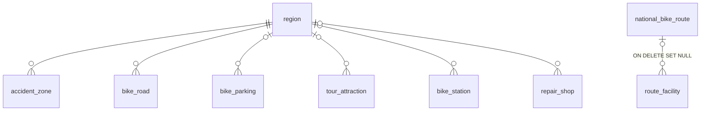
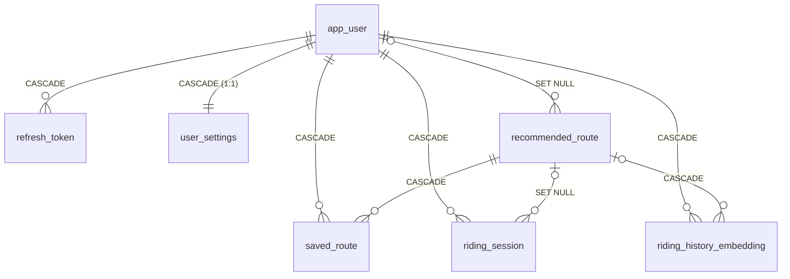

# RIDELY DB 문서

> 라이들리 백엔드의 **활용 공공데이터 · DB 구조 · ERD** 정리.
> 정본은 Flyway 마이그레이션(`src/main/resources/db/migration/V1~V4`)이며, 이 문서는 그 요약본이다.
> 공공데이터의 결함·실측·이용허락 상세는 `docs/shared/DATA_SOURCES.md`를 본다.

---

## 1. 개요

| 항목 | 내용 |
|---|---|
| DBMS | PostgreSQL 16 |
| 확장 | **PostGIS**(공간 쿼리), **pgvector**(RAG 임베딩, 아직 미활성) |
| 좌표계 | SRID **4326** (WGS84 위경도) |
| 스키마 관리 | Flyway (`V1__initial_schema` ~ `V4__recommendation_cache_idempotency`). **적용된 파일은 수정 금지**(체크섬 검증) |
| 접근 방식 | 단순 CRUD = MyBatis(`resources/mapper/*.xml`) / 공간·벡터 연산 = `JdbcClient` 원시 SQL (ADR-002) |
| 명명 규칙 | 테이블명 단수형, PK는 `{테이블명}_id`. 예외로 `user_settings` |
| 테이블 수 | **17개** (공공데이터 9 + 서비스 8) |
| 서비스 범위 | MVP는 한강 서울 구간(아라한강갑문~잠실, 약 40km)으로 제한 |

### 마이그레이션 이력

| 버전 | 내용 |
|---|---|
| V1 | 초기 스키마 17개 테이블 + `region` 시드(서울 11 / 인천 28 / 경기 41) |
| V2 | `repair_shop`에 `(shop_name, geom)` 유니크 인덱스 — 소스에 신뢰할 고유키가 없어 자연키로 멱등 적재 |
| V3 | `accident_zone.polygon_geom`을 `Polygon` → `MultiPolygon`으로 변경 (실호출에서 MultiPolygon 응답 확인) |
| V4 | `recommendation_cache` 주석 정정 — 조건 기반 캐시가 아니라 `Idempotency-Key` 기반 멱등성 저장소 (구조 변경 없음) |

---

## 2. 활용 공공데이터

### 2.1 적재 대상 (DB에 저장)

| # | 데이터 | 제공기관 | 방식 | 식별번호 | 적재 테이블 | 적재 규모 | 이용허락 |
|---|---|---|---|---|---|---|---|
| 1 | 국문 관광정보 서비스_GW (TourAPI, `KorService2`) | 한국관광공사 | API | 15101578 | `tour_attraction` | 710건 | 제한 없음 (사진은 별도 제약) |
| 2 | 자전거길 DB (국토종주 13길) | 행정안전부 | 파일(CSV, CP949) | 3038533 | `national_bike_route`, `route_facility` | 13노선 / 시설 1,024건 | 제한 없음 |
| 3 | 서울시 자전거 편의시설 (`tvBicycleEtc`) | 서울특별시 | API | — | `route_facility`(AIR_PUMP), `repair_shop` | 공기주입기 1,100 / 수리센터 24 | 공공누리 1유형 |
| 4 | 서울시 공공자전거 대여소 정보 (`tbCycleStationInfo`) | 서울특별시 | API | — | `bike_station` | 3,239건 | 공공누리 1유형 |
| 5 | 자전거 교통사고 다발지역 (TAAS) | 도로교통공단 | API | 15056681 | `accident_zone` | 2024년 111건 + 2023년 91건 = 202건 | 제한 없음 |

### 2.2 테이블은 있으나 아직 적재하지 않음

| 데이터 | 제공기관 | 적재 테이블 | 상태 |
|---|---|---|---|
| 자전거보관소정보 조회서비스 (15155044) | 행정안전부 | `bike_parking` | 검증 완료(서울 2,698건), 적재 예정 |
| 전국자전거도로표준데이터 (15100063) | 행정안전부 | `bike_road` | **차후 반영** — 노선 형상 없음, 이용허락 표기 없음(착수 전 확인 필요) |

### 2.3 DB에 넣지 않는 데이터 / 미채택

| 데이터 | 처리 |
|---|---|
| 서울시 공공자전거 **실시간** 대여정보 (`bikeList`) | 잔여 대수는 변동이 잦아 DB 미적재, 필요 시 실시간 호출 |
| 자전거대여수리점안내 (한국수자원공사) | 보류 — 서울 0건, MVP 구간 밖 |
| V-World WMS/WFS | 미채택 — 고유 관리번호 없음 + 자체 약관(복제·변경 제한) |
| 두루누비 / 생활안전지도 자전거길 / 자전거길(사고지점) | 미채택 — 자전거 코스 0건 / WMS(이미지)만 제공 |

### 2.4 데이터셋 ↔ 테이블 매핑

```
한국관광공사 TourAPI ──────────────► tour_attraction
행안부 자전거길 DB(CSV) ─┬─ 노선 좌표 ─► national_bike_route
                        └─ 주변시설 ──► route_facility (CERT_CENTER / TOILET / WATER / AIR_PUMP)
서울시 tvBicycleEtc ───┬─ '주입기' ───► route_facility (AIR_PUMP)
                       ├─ 수리 정보 ──► repair_shop
                       └─ 거치대 등 ──► (적재 안 함)
서울시 tbCycleStationInfo ─────────► bike_station
도로교통공단 TAAS ─────────────────► accident_zone
행안부 자전거보관소 API ───────────► bike_parking   (적재 예정)
행안부 전국자전거도로표준데이터 ───► bike_road      (차후)
```

### 2.5 공공데이터 외 외부 서비스 (DB 적재 없음)

| 서비스 | 용도 |
|---|---|
| OpenRouteService | 자전거 경로 라우팅 (도로 형상·고도) |
| Kakao Local | 주소·장소명 → 좌표 (장소 검색) |
| LLM (Gemini / Bedrock Claude / LiteLLM 게이트웨이) | 코스 설계, 코칭 코멘트 생성 |

---

## 3. ERD

### 3.1 전체 ERD

공공데이터 테이블과 서비스 테이블 사이에는 **FK가 없다.** 추천 파이프라인은 PostGIS 공간 쿼리(`ST_DWithin` 등)로 POI를 읽고, 결과는 `recommended_route.waypoints_json`(JSONB)에 스냅샷으로 저장한다.

```mermaid
erDiagram
    region ||--o{ region : "parent_id"
    region ||--o{ accident_zone : "region_id"
    region ||--o{ bike_road : "region_id"
    region |o--o{ bike_parking : "region_id"
    region |o--o{ tour_attraction : "region_id"
    region |o--o{ bike_station : "region_id"
    region |o--o{ repair_shop : "region_id"
    national_bike_route |o--o{ route_facility : "national_bike_route_id"

    app_user ||--o{ refresh_token : "user_id"
    app_user ||--|| user_settings : "user_id"
    app_user |o--o{ recommended_route : "user_id"
    app_user ||--o{ saved_route : "user_id"
    app_user ||--o{ riding_session : "user_id"
    app_user ||--o{ riding_history_embedding : "user_id"
    recommended_route ||--o{ saved_route : "recommended_route_id"
    recommended_route |o--o{ riding_session : "recommended_route_id"
    recommended_route |o--o{ riding_history_embedding : "recommended_route_id"

    region {
        bigserial region_id PK
        varchar region_code UK
        varchar region_name
        bigint parent_id FK
        timestamptz created_at
    }
    accident_zone {
        bigserial accident_zone_id PK
        bigint region_id FK
        varchar afos_fid "UK(afos_fid,data_year)"
        int data_year "UK(afos_fid,data_year)"
        varchar danger_level "CAUTION/WARNING/DANGER"
        int occurrence_count
        geometry center_geom "Point"
        geometry polygon_geom "MultiPolygon"
    }
    bike_road {
        bigserial bike_road_id PK
        bigint region_id FK
        varchar route_name
        numeric total_length_km
        geometry start_geom "Point"
        geometry end_geom "Point"
        geometry line_geom "LineString"
    }
    national_bike_route {
        bigserial national_bike_route_id PK
        varchar route_name UK
        numeric total_length_km
        geometry line_geom "MultiLineString"
    }
    route_facility {
        bigserial route_facility_id PK
        bigint national_bike_route_id FK
        varchar facility_type "CERT_CENTER/TOILET/WATER/AIR_PUMP/ETC"
        varchar facility_name
        geometry geom "Point"
    }
    bike_parking {
        bigserial bike_parking_id PK
        bigint region_id FK
        varchar mgmt_no UK
        varchar parking_name
        geometry geom "Point"
        jsonb raw_attrs
    }
    tour_attraction {
        bigserial tour_attraction_id PK
        bigint region_id FK
        varchar content_id UK
        varchar content_type_id "12/14/15/25/28/32/38/39"
        varchar title
        geometry geom "Point"
        text overview
        timestamptz source_modified_at
    }
    bike_station {
        bigserial bike_station_id PK
        bigint region_id FK
        varchar station_code UK
        varchar station_name
        geometry geom "Point"
        int rack_count
        boolean is_active
    }
    repair_shop {
        bigserial repair_shop_id PK
        bigint region_id FK
        varchar shop_name "UK(shop_name,geom)"
        geometry geom "Point, UK(shop_name,geom)"
        boolean is_free
        varchar tel
    }
    app_user {
        bigserial user_id PK
        varchar login_id UK
        varchar password_hash
        varchar nickname
        varchar status "ACTIVE/SUSPENDED/WITHDRAWN"
    }
    refresh_token {
        bigserial refresh_token_id PK
        bigint user_id FK
        varchar token_hash
        timestamptz expires_at
        timestamptz revoked_at
    }
    user_settings {
        bigserial user_settings_id PK
        bigint user_id FK "UK"
        boolean avoid_danger_zones
        numeric default_priority_convenience
        numeric default_priority_exercise
        numeric default_priority_scenery
        varchar units "km/mile"
    }
    recommended_route {
        bigserial recommended_route_id PK
        bigint user_id FK "NULL=비회원"
        geometry start_geom "Point"
        geometry end_geom "Point"
        numeric target_distance_km
        geometry route_geom "LineString"
        numeric total_distance_km
        varchar intensity_level "LIGHT/MODERATE/HARD/CHALLENGE"
        jsonb waypoints_json
        jsonb passing_danger_zones_json
        text ai_coach_comment
        varchar llm_provider
    }
    saved_route {
        bigserial saved_route_id PK
        bigint user_id FK "UK(user_id,recommended_route_id)"
        bigint recommended_route_id FK "UK(user_id,recommended_route_id)"
        varchar custom_name
        boolean is_favorite
    }
    recommendation_cache {
        bigserial recommendation_cache_id PK
        varchar cache_key UK "SHA256(user_id|Idempotency-Key)"
        jsonb response_payload
        timestamptz expires_at
    }
    riding_session {
        bigserial riding_session_id PK
        bigint user_id FK
        bigint recommended_route_id FK
        timestamptz started_at
        timestamptz ended_at
        numeric distance_km
        boolean is_completed
        geometry track_geom "LineString"
    }
    riding_history_embedding {
        bigserial riding_history_embedding_id PK
        bigint user_id FK
        bigint recommended_route_id FK
        text preference_text
        vector embedding "768차원"
    }
```



### 3.2 공공데이터 영역 (가독성용 분리도)



### 3.3 서비스 영역 (가독성용 분리도)



`recommendation_cache`는 어떤 테이블과도 FK가 없는 독립 테이블이다.

---

## 4. 테이블 상세

### 4.1 공공데이터 테이블

#### `region` — 지역 코드 마스터
| 컬럼 | 타입 | 제약 | 설명 |
|---|---|---|---|
| region_id | BIGSERIAL | PK | |
| region_code | VARCHAR(20) | UNIQUE, NOT NULL | 시드: 11 서울 / 28 인천 / 41 경기 |
| region_name | VARCHAR(50) | NOT NULL | |
| parent_id | BIGINT | FK → region | 자기참조(계층) |
| created_at | TIMESTAMPTZ | NOT NULL | |

> MVP는 수도권만 쓰고, 전국 확장 시 데이터만 추가한다.

#### `accident_zone` — 자전거 사고다발지역 (TAAS)
| 컬럼 | 타입 | 설명 |
|---|---|---|
| accident_zone_id | BIGSERIAL PK | |
| region_id | BIGINT FK → region, NOT NULL | 매핑은 이름이 아니라 `bjd_cd` 앞 2자리 |
| afos_fid | VARCHAR(30) NOT NULL | API 고유 식별자 (**연도 간 재사용되지 않음**) |
| bjd_code / spot_code | VARCHAR | 법정동코드 / 지점코드 |
| sido_sgg_name / spot_name | VARCHAR | 시도시군구명 / 지점명 |
| occurrence_count / casualty_count / death_count / serious_inj_count / minor_inj_count / report_inj_count | INT | 발생·사상·사망·중상·경상·부상신고 |
| danger_level | VARCHAR(20) NOT NULL | 자체 파생 등급. `CAUTION`(4~5건) / `WARNING`(6~9건) / `DANGER`(10건+ 또는 사망 포함) |
| data_year | INT NOT NULL | 조회 사고년도 |
| center_geom | GEOMETRY(Point,4326) NOT NULL | 중심 경위도 |
| polygon_geom | GEOMETRY(MultiPolygon,4326) | 다발지역 폴리곤 (V3에서 MultiPolygon으로 통일) |

- UNIQUE `(afos_fid, data_year)` — 재적재 멱등성
- 인덱스: GIST(center_geom, polygon_geom), region_id, danger_level, data_year
- 용도: 지도 히트맵 / 라이딩 중 근접 알림 / ORS `avoid_polygons` 회피. 코스 추천 조회는 `data_year` 최댓값만 본다.

#### `bike_road` — 전국자전거도로표준데이터 *(미적재)*
| 컬럼 | 타입 | 설명 |
|---|---|---|
| bike_road_id | BIGSERIAL PK | |
| region_id | BIGINT FK NOT NULL | |
| route_name | VARCHAR(200) NOT NULL | 노선명 |
| route_no, sido_name, sigungu_name | VARCHAR | 노선번호 / 시도 / 시군구 |
| start_addr_road, start_addr_jibun, end_addr_road, end_addr_jibun | VARCHAR(300) | 기점·종점 주소 |
| start_geom, end_geom | GEOMETRY(Point,4326) | 기점·종점 (결측 多) |
| via_points | VARCHAR(500) | 주요 경유지 |
| total_length_km | NUMERIC(7,2) | 총길이 |
| road_width_m, bike_width_m | NUMERIC(5,1) | 도로·자전거도로 너비 |
| road_type | VARCHAR(50) | 전용도로 / 겸용도로 / 전용차로 / 우선도로 |
| is_notified | BOOLEAN | 고시 유무 |
| mgmt_agency, mgmt_phone | VARCHAR | 관리기관 |
| data_std_date | DATE | 데이터기준일자 |
| line_geom | GEOMETRY(LineString,4326) | 소스에 형상이 없어 후보강 대상 |

- 인덱스: GIST(start_geom, line_geom), region_id, road_type

#### `national_bike_route` — 국토종주 자전거길 13개 노선
| 컬럼 | 타입 | 설명 |
|---|---|---|
| national_bike_route_id | BIGSERIAL PK | |
| route_name | VARCHAR(100) UNIQUE NOT NULL | 예: 한강종주자전거길 |
| start_desc, end_desc | VARCHAR(200) | 기점·종점 설명 |
| total_length_km | NUMERIC(6,1) | **공식 안내 거리**(ST_Length 계산값 아님). 노선 간 합산 금지 — 한강종주 192km가 남한강 132km를 포함 |
| line_geom | GEOMETRY(MultiLineString,4326) NOT NULL | 좌표 간격 3km 초과 시 파트 분리 (Y자 분기를 이으면 37km 가짜 직선이 생김) |

- 전국 노선이라 region FK 없음. 인덱스: GIST(line_geom).
- 이 테이블이 비면 `extendIfShort` 거리 보정이 경고만 남기고 건너뛴다 → 조용히 짧은 코스가 나온다.

#### `route_facility` — 자전거길 주변 시설
| 컬럼 | 타입 | 설명 |
|---|---|---|
| route_facility_id | BIGSERIAL PK | |
| national_bike_route_id | BIGINT FK → national_bike_route | `ON DELETE SET NULL`. 좌표 기반 `ST_DWithin` 500m 최근접으로 채움 (1,009/1,024 = 98.5% 연결) |
| facility_type | VARCHAR(20) NOT NULL | `CERT_CENTER` / `TOILET` / `WATER` / `AIR_PUMP` / `ETC` |
| facility_name | VARCHAR(200) | |
| geom | GEOMETRY(Point,4326) NOT NULL | |

- UNIQUE INDEX `uq_facility_natural (facility_type, COALESCE(facility_name,''), geom)` — 행안부 CSV·서울시 API 두 소스가 함께 쓰므로 `ON CONFLICT DO NOTHING`으로 적재 순서 무관하게 멱등
- 인덱스: GIST(geom), facility_type, national_bike_route_id
- 급수대가 여기 포함되므로 별도 `water_fountain` 테이블은 없다.

#### `bike_parking` — 자전거 보관소 *(적재 예정)*
| 컬럼 | 타입 | 설명 |
|---|---|---|
| bike_parking_id | BIGSERIAL PK | |
| region_id | BIGINT FK | 좌표 역매핑, 실패 시 NULL |
| mgmt_no | VARCHAR(30) UNIQUE NOT NULL | 행안부 `MNG_NO`. 매일 갱신 소스라 이 값 기준 UPSERT |
| parking_name | VARCHAR(200) | |
| geom | GEOMETRY(Point,4326) NOT NULL | 실제 좌표계는 WGS84 (명세의 EPSG:5174 표기는 오류) |
| mgmt_agency | VARCHAR(100) | |
| raw_attrs | JSONB | 원본 속성 보존 |

- 보관소(거치대)이며 따릉이 대여소가 아니다.

#### `tour_attraction` — 관광 콘텐츠 (TourAPI)
| 컬럼 | 타입 | 설명 |
|---|---|---|
| tour_attraction_id | BIGSERIAL PK | |
| region_id | BIGINT FK | |
| content_id | VARCHAR(20) UNIQUE NOT NULL | TourAPI `contentid` — 재적재 멱등성 |
| content_type_id | VARCHAR(2) NOT NULL | 12 관광지 / 14 문화시설 / 15 축제공연행사 / 25 여행코스 / 28 레포츠 / 32 숙박 / 38 쇼핑 / 39 음식점 (현재 적재는 12·14) |
| title | VARCHAR(300) NOT NULL | |
| cat1, cat2, cat3 | VARCHAR(10) | **사용중지 필드 — 항상 NULL로 유지** |
| addr1, addr2 | VARCHAR | 주소 |
| geom | GEOMETRY(Point,4326) NOT NULL | `mapx`=경도, `mapy`=위도 |
| tel, first_image_url, thumbnail_url | VARCHAR | 사진은 화면 표시에만 사용 |
| overview | TEXT | `detailCommon` 개요 |
| event_start_date, event_end_date | DATE | 행사(15) 전용 |
| area_code, sigungu_code | VARCHAR(10) | 사용중지 필드 |
| source_modified_at | TIMESTAMPTZ | `modifiedtime` — 증분 동기화 기준 |
| created_at, updated_at | TIMESTAMPTZ | |

- 인덱스: GIST(geom), content_type_id, region_id, source_modified_at, 부분 인덱스(event 기간, `content_type_id='15'`)

#### `bike_station` — 따릉이 대여소 마스터
| 컬럼 | 타입 | 설명 |
|---|---|---|
| bike_station_id | BIGSERIAL PK | |
| region_id | BIGINT FK | |
| station_code | VARCHAR(20) UNIQUE NOT NULL | 응답 `RENT_ID` (예: `ST-10`) — UPSERT 키 |
| station_name | VARCHAR(200) NOT NULL | `RENT_NM` |
| geom | GEOMETRY(Point,4326) NOT NULL | `STA_LONG`/`STA_LAT` |
| rack_count | INT | `HOLD_NUM` 거치대 수 |
| is_active | BOOLEAN NOT NULL DEFAULT TRUE | 이번 적재에 안 들어온 대여소는 비활성 처리(`deactivate_stale`) |
| created_at, updated_at | TIMESTAMPTZ | |

- 실시간 잔여 대수는 DB에 없다(서울시 실시간 API 직접 호출).

#### `repair_shop` — 자전거 수리센터
| 컬럼 | 타입 | 설명 |
|---|---|---|
| repair_shop_id | BIGSERIAL PK | |
| region_id | BIGINT FK | |
| shop_name | VARCHAR(200) NOT NULL | |
| geom | GEOMETRY(Point,4326) NOT NULL | |
| addr, operating_hours, tel | VARCHAR | |
| is_free | BOOLEAN NOT NULL DEFAULT FALSE | 자치구 무료 수리소 여부 |

- UNIQUE INDEX `uq_repair_shop_natural (shop_name, geom)` (V2) — 소스 `FCLT_ID`를 신뢰할 수 없어 자연키 사용
- 판정 규칙: `DTL_INFO_VL06`(운영형태) 또는 `VL07`(수리범위)이 채워진 시설 (`SeoulFacilityClassifier`)

### 4.2 서비스 테이블

#### `app_user` — 회원
| 컬럼 | 타입 | 설명 |
|---|---|---|
| user_id | BIGSERIAL PK | |
| login_id | VARCHAR(50) UNIQUE NOT NULL | |
| password_hash | VARCHAR(255) NOT NULL | |
| nickname | VARCHAR(50) NOT NULL | |
| email | VARCHAR(100) | |
| status | VARCHAR(20) NOT NULL DEFAULT 'ACTIVE' | `ACTIVE` / `SUSPENDED` / `WITHDRAWN` |
| last_login_at, created_at, updated_at | TIMESTAMPTZ | |

#### `refresh_token` — JWT 리프레시 토큰
| 컬럼 | 타입 | 설명 |
|---|---|---|
| refresh_token_id | BIGSERIAL PK | |
| user_id | BIGINT FK → app_user, `ON DELETE CASCADE` | |
| token_hash | VARCHAR(255) NOT NULL | 토큰 원문이 아닌 해시 저장 |
| expires_at | TIMESTAMPTZ NOT NULL | |
| revoked_at | TIMESTAMPTZ | 회전·폐기 시각 |

- 액세스 토큰은 15분·무상태·폐기 불가, 리프레시 토큰만 DB 기반(회전·폐기 가능).

#### `user_settings` — 환경설정 (1:1)
| 컬럼 | 타입 | 설명 |
|---|---|---|
| user_settings_id | BIGSERIAL PK | |
| user_id | BIGINT UNIQUE FK, `ON DELETE CASCADE` | 회원당 1행 |
| avoid_danger_zones | BOOLEAN DEFAULT FALSE | TRUE면 ORS `avoid_polygons` 자동 적용 |
| default_priority_convenience / exercise / scenery | NUMERIC(3,2) | 기본 0.50 / 0.30 / 0.20, 각 0~1 (합계 1.00은 앱 레이어 검증) |
| units | VARCHAR(10) DEFAULT 'km' | `km` / `mile` |
| notification_enabled, vibration_enabled | BOOLEAN DEFAULT TRUE | |

#### `recommended_route` — AI 추천 경로 기록
| 컬럼 | 타입 | 설명 |
|---|---|---|
| recommended_route_id | BIGSERIAL PK | |
| user_id | BIGINT FK, `ON DELETE SET NULL` | **NULL = 비회원 추천** (공개 엔드포인트) |
| start_geom / end_geom | GEOMETRY(Point,4326) | 사용자가 *선택한* 출발·도착 좌표 (GPS 아님) |
| target_distance_km | NUMERIC(5,2) | |
| priority_convenience / exercise / scenery | NUMERIC(3,2) | |
| avoid_danger_zones_applied | BOOLEAN | |
| route_geom | GEOMETRY(LineString,4326) | ORS 도로 형상 |
| total_distance_km, estimated_duration_min, total_ascent_m, total_descent_m | | 거리·시간·고도 |
| intensity_level | VARCHAR(20) | `LIGHT` / `MODERATE` / `HARD` / `CHALLENGE` |
| waypoints_json | JSONB | 경유지 스냅샷 (GIN 인덱스) |
| passing_danger_zones_json | JSONB | 통과하는 사고다발지 |
| ai_title, ai_highlights(JSONB), ai_coach_comment, ai_danger_zone_alert, ai_next_step_suggestion | | LLM 생성 코멘트 |
| llm_provider | VARCHAR(30) | 하나라도 폴백이면 `FALLBACK` |

- 인덱스: user_id, created_at DESC, GIST(start_geom, route_geom), GIN(waypoints_json)

#### `saved_route` — 저장한 경로
| 컬럼 | 타입 | 설명 |
|---|---|---|
| saved_route_id | BIGSERIAL PK | |
| user_id | BIGINT FK, `CASCADE` | |
| recommended_route_id | BIGINT FK, `CASCADE` | |
| custom_name, memo | | |
| is_favorite | BOOLEAN DEFAULT FALSE | |

- UNIQUE `(user_id, recommended_route_id)` — 같은 경로 중복 저장 방지

#### `recommendation_cache` — 추천 응답 멱등성 저장소
| 컬럼 | 타입 | 설명 |
|---|---|---|
| recommendation_cache_id | BIGSERIAL PK | |
| cache_key | VARCHAR(64) UNIQUE NOT NULL | `SHA256(user_id + "\|" + Idempotency-Key 헤더)`. 비회원은 user_id 자리가 빈 문자열 |
| response_payload | JSONB NOT NULL | `{"request": …, "response": …}` — 같은 키에 다른 요청이 오는지 판별하려고 요청도 함께 저장 |
| expires_at | TIMESTAMPTZ NOT NULL | `NOW() + ridely.route.cache-ttl-minutes`(20분). 만료 행은 지우지 않고 ON CONFLICT로 덮어씀 |

- 이름은 캐시지만 조건 기반 캐시가 아니다(GPS 오차·재추천 갇힘 문제로 폐기, V4).

#### `riding_session` — 라이딩 세션
| 컬럼 | 타입 | 설명 |
|---|---|---|
| riding_session_id | BIGSERIAL PK | |
| user_id | BIGINT FK, `CASCADE` | |
| recommended_route_id | BIGINT FK, `ON DELETE SET NULL` | NULL = 자유 라이딩 |
| started_at / ended_at | TIMESTAMPTZ | `ended_at IS NULL` = 진행 중. CHECK `ended_at >= started_at` |
| distance_km, avg_speed_kmh | NUMERIC | |
| is_completed | BOOLEAN DEFAULT FALSE | 완주율 분자 |
| visited_poi_count, alert_received_count | INT DEFAULT 0 | |
| track_geom | GEOMETRY(LineString,4326) | GPS 트랙 |

> ⚠️ **위치 프라이버시 규칙**: 기기 GPS(원본·반올림·격자·파생 거리/속도/트랙 모두)는 서버로 보내지 않는다. 현재 프런트엔드는 라이딩 기록을 `localStorage`에만 저장하고 서버 라이딩 세션 API를 호출하지 않는다. 이 테이블·엔드포인트는 스키마와 API로만 존재한다.

#### `riding_history_embedding` — RAG용 벡터 *(미활성)*
| 컬럼 | 타입 | 설명 |
|---|---|---|
| riding_history_embedding_id | BIGSERIAL PK | |
| user_id | BIGINT FK, `CASCADE` | |
| recommended_route_id | BIGINT FK, `CASCADE` | |
| distance_km | NUMERIC(7,3) | |
| intensity_level | VARCHAR(20) | `LIGHT`/`MODERATE`/`HARD`/`CHALLENGE` |
| preference_text | TEXT NOT NULL | `"{distance}km {intensity} 코스, 주요 경유: …, 출발지역: …"` |
| embedding | vector(768) NOT NULL | 임베딩 벡터 |

- 인덱스: user_id, (user_id, created_at DESC), **HNSW(embedding vector_cosine_ops)**
- `application.yml`의 `spring.ai.vectorstore` 블록이 주석 처리돼 있어 아직 사용하지 않는다.

---

## 5. 인덱스·공간 쿼리 요약

| 구분 | 인덱스 | 용도 |
|---|---|---|
| 공간(GIST) | `accident_zone.center_geom/polygon_geom`, `bike_road.start_geom/line_geom`, `national_bike_route.line_geom`, `route_facility.geom`, `bike_parking.geom`, `tour_attraction.geom`, `bike_station.geom`, `repair_shop.geom`, `recommended_route.start_geom/route_geom`, `riding_session.track_geom` | `ST_DWithin` 반경 검색, `ST_Intersects` 폴리곤 교차(사고다발지 통과 판정) |
| 벡터(HNSW) | `riding_history_embedding.embedding` | 코사인 거리 유사도 검색 |
| JSONB(GIN) | `recommended_route.waypoints_json` | 경유지 검색 |
| 부분 인덱스 | `tour_attraction(event_start_date, event_end_date) WHERE content_type_id='15'` | 축제 기간 필터 |
| 자연키 UNIQUE | `route_facility`(종류·이름·좌표), `repair_shop`(이름·좌표) | 고유키가 없는 소스의 멱등 재적재 |

## 6. 적재 멱등성 전략

| 테이블 | 키 | 방식 |
|---|---|---|
| tour_attraction | `content_id` | UPSERT |
| bike_station | `station_code` | UPSERT + 미등장 대여소 비활성화 |
| bike_parking | `mgmt_no` | UPSERT (예정) |
| accident_zone | `(afos_fid, data_year)` | UPSERT (연도별 누적) |
| route_facility | `(facility_type, COALESCE(name,''), geom)` | `ON CONFLICT DO NOTHING` — 두 소스가 AIR_PUMP를 모두 제공하므로 소스별 DELETE 금지 |
| repair_shop | `(shop_name, geom)` | `ON CONFLICT DO NOTHING` |
| national_bike_route | `route_name` UNIQUE | 노선 단위 |

`db/seed/`의 원본 CSV는 `.gitignore` 대상이며(공공데이터 미러를 저장소에 두지 않는다), `POST /api/v1/poc/seed/bike-routes` → `…/route-facilities` 순서로 적재한다(시설이 노선에 연결되므로 노선이 먼저).
