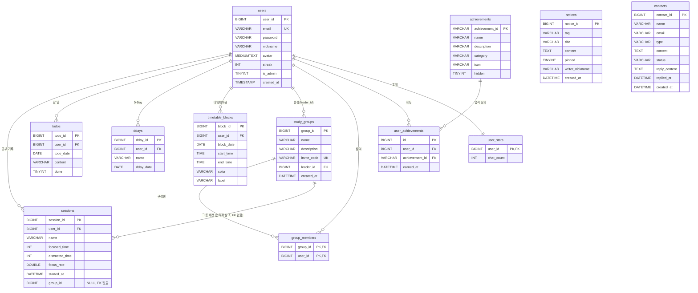

# WATCHMAN DB 문서

Watchman 프로젝트의 데이터베이스 구조 및 ERD 문서입니다.

- **DBMS:** MySQL (InnoDB, `utf8mb4`)
- **접속 정보:** `localhost:3308` / DB `watchman` / 계정 `watchman_db`
- **접근 방식:** ORM 없이 `JdbcTemplate` + `BeanPropertyRowMapper` (snake_case 컬럼 ↔ camelCase 필드 자동 매핑)
- **스키마 정의:** `src/main/resources/schema.sql` (`spring.sql.init.mode=always`로 서버 시작 시마다 실행, `IF NOT EXISTS`로 멱등)
- **추가 마이그레이션 / 시드:** `com.watchman.config.DataInitializer` (`ApplicationRunner`)

---

## 1. 테이블 목록 (총 12개)

| # | 테이블 | 설명 | 도메인 클래스 |
|---|--------|------|---------------|
| 1 | `users` | 사용자 계정 | `User` |
| 2 | `sessions` | 공부(집중) 세션 기록 | `Session` |
| 3 | `todos` | 일별 할 일 | `Todo` |
| 4 | `ddays` | D-Day | `DDay` |
| 5 | `timetable_blocks` | 플래너 타임테이블 블록 | `TimetableBlock` |
| 6 | `study_groups` | 스터디 그룹 | `StudyGroup` |
| 7 | `group_members` | 그룹-사용자 N:M 매핑 | `StudyGroupMember` |
| 8 | `achievements` | 업적 마스터 (30개) | `Achievement` |
| 9 | `user_achievements` | 사용자별 획득 업적 | `UserAchievement` |
| 10 | `user_stats` | 사용자 통계 (채팅 횟수) | - |
| 11 | `notices` | 공지사항 | `Notice` |
| 12 | `contacts` | 문의 및 관리자 답변 | `Contact` |

> `notices`, `contacts`는 다른 테이블과 FK 관계가 없는 독립 테이블입니다.

---

## 2. ERD

---

## 3. 테이블 상세

### 3.1 `users` — 사용자

| 컬럼 | 타입 | NULL | 기본값 | 키 | 설명 |
|------|------|------|--------|----|------|
| `user_id` | BIGINT | N | AUTO_INCREMENT | PK | 사용자 ID |
| `email` | VARCHAR(255) | N | | UNIQUE | 로그인 이메일 |
| `password` | VARCHAR(255) | N | | | BCrypt 해시 |
| `nickname` | VARCHAR(100) | N | | | 닉네임 |
| `avatar` | MEDIUMTEXT | Y | NULL | | 프로필 이미지 (인코딩 문자열) |
| `streak` | INT | N | 0 | | 연속 출석 일수 |
| `is_admin` | TINYINT(1) | N | 0 | | 관리자 여부 |
| `created_at` | TIMESTAMP | N | CURRENT_TIMESTAMP | | 가입일시 |

- 기본 관리자: `admin@watchman.com` / `admin1234!` (`INSERT IGNORE`). 평문으로 들어간 비밀번호는 `DataInitializer.migrateAdminPassword()`가 시작 시 BCrypt로 변환.

### 3.2 `sessions` — 공부 세션

| 컬럼 | 타입 | NULL | 기본값 | 키 | 설명 |
|------|------|------|--------|----|------|
| `session_id` | BIGINT | N | AUTO_INCREMENT | PK | 세션 ID |
| `user_id` | BIGINT | N | | FK → `users` | 소유자 (ON DELETE CASCADE) |
| `name` | VARCHAR(100) | N | `''` | | 세션 이름 |
| `focused_time` | INT | N | 0 | | 집중 시간(초) |
| `distracted_time` | INT | N | 0 | | 비집중 시간(초) |
| `focus_rate` | DOUBLE | N | 0 | | 집중률 (서버가 계산, 소수 2자리 HALF_UP) |
| `started_at` | DATETIME | N | CURRENT_TIMESTAMP | | 시작 시각 |
| `group_id` | BIGINT | Y | NULL | (FK 없음) | 그룹 스터디 세션이면 그룹 ID, 솔로면 NULL |

- `group_id`는 `schema.sql`에는 없고 `DataInitializer`가 `ALTER TABLE`로 추가함.
- `name`은 `schema.sql`에도 있으나, 구버전 DB를 위해 `DataInitializer`가 누락 시 추가.

### 3.3 `todos` — 할 일

| 컬럼 | 타입 | NULL | 기본값 | 키 | 설명 |
|------|------|------|--------|----|------|
| `todo_id` | BIGINT | N | AUTO_INCREMENT | PK | |
| `user_id` | BIGINT | N | | FK → `users` | ON DELETE CASCADE |
| `todo_date` | DATE | N | | | 할 일 날짜 |
| `content` | VARCHAR(500) | N | | | 내용 |
| `done` | TINYINT(1) | N | 0 | | 완료 여부 |

### 3.4 `ddays` — D-Day

| 컬럼 | 타입 | NULL | 기본값 | 키 | 설명 |
|------|------|------|--------|----|------|
| `dday_id` | BIGINT | N | AUTO_INCREMENT | PK | |
| `user_id` | BIGINT | N | | FK → `users` | ON DELETE CASCADE |
| `name` | VARCHAR(200) | N | | | D-Day 이름 |
| `dday_date` | DATE | N | | | 목표 날짜 |

### 3.5 `timetable_blocks` — 타임테이블 블록

| 컬럼 | 타입 | NULL | 기본값 | 키 | 설명 |
|------|------|------|--------|----|------|
| `block_id` | BIGINT | N | AUTO_INCREMENT | PK | |
| `user_id` | BIGINT | N | | FK → `users` | ON DELETE CASCADE |
| `block_date` | DATE | N | | | 날짜 |
| `start_time` | TIME | N | | | 시작 시간 |
| `end_time` | TIME | N | | | 종료 시간 |
| `color` | VARCHAR(20) | N | `#bfdbfe` | | 블록 색상 |
| `label` | VARCHAR(200) | N | `''` | | 블록 텍스트 |

### 3.6 `study_groups` — 스터디 그룹

| 컬럼 | 타입 | NULL | 기본값 | 키 | 설명 |
|------|------|------|--------|----|------|
| `group_id` | BIGINT | N | AUTO_INCREMENT | PK | |
| `name` | VARCHAR(100) | N | | | 그룹명 |
| `description` | VARCHAR(500) | Y | NULL | | 설명 |
| `invite_code` | VARCHAR(10) | N | | UNIQUE | 초대 코드 |
| `leader_id` | BIGINT | N | | FK → `users` | 방장 (ON DELETE CASCADE) |
| `created_at` | DATETIME | N | CURRENT_TIMESTAMP | | 생성일시 |

### 3.7 `group_members` — 그룹 구성원 (N:M)

| 컬럼 | 타입 | NULL | 키 | 설명 |
|------|------|------|----|------|
| `group_id` | BIGINT | N | PK, FK → `study_groups` | ON DELETE CASCADE |
| `user_id` | BIGINT | N | PK, FK → `users` | ON DELETE CASCADE |

- 복합 PK `(group_id, user_id)`로 중복 가입 방지.

### 3.8 `achievements` — 업적 마스터

| 컬럼 | 타입 | NULL | 기본값 | 키 | 설명 |
|------|------|------|--------|----|------|
| `achievement_id` | VARCHAR(50) | N | | PK | 문자열 코드 (예: `study_first`) |
| `name` | VARCHAR(100) | N | | | 업적명 |
| `description` | VARCHAR(255) | N | | | 달성 조건 설명 |
| `category` | VARCHAR(50) | N | | | 카테고리 |
| `icon` | VARCHAR(10) | N | | | 이모지 아이콘 |
| `hidden` | TINYINT(1) | N | 0 | | 히든(이스터에그) 여부 |

- 30개 시드 데이터는 `DataInitializer.insertAchievementData()`가 `INSERT IGNORE`로 입력.

| 카테고리 | 개수 | ID |
|----------|------|----|
| `study` | 6 | study_first, study_1h, study_3h, study_10h, study_50h, study_100h |
| `focus` | 4 | focus_50, focus_80, focus_95, focus_master |
| `streak` | 4 | streak_3, streak_7, streak_14, streak_30 |
| `group` | 4 | group_join, group_leader, group_session_10, group_chat_50 |
| `planner` | 7 | plan_first_todo, plan_todo_10, plan_todo_50, plan_perfect_day, plan_dday_add, plan_block_10, plan_streak_plan |
| `easter` (hidden=1) | 5 | egg_dawn, egg_weekend, egg_planner, egg_dday, egg_midnight |

### 3.9 `user_achievements` — 사용자 획득 업적

| 컬럼 | 타입 | NULL | 기본값 | 키 | 설명 |
|------|------|------|--------|----|------|
| `id` | BIGINT | N | AUTO_INCREMENT | PK | |
| `user_id` | BIGINT | N | | FK → `users` | ON DELETE CASCADE |
| `achievement_id` | VARCHAR(50) | N | | FK → `achievements` | (CASCADE 없음) |
| `earned_at` | DATETIME | N | CURRENT_TIMESTAMP | | 획득 시각 |

- `UNIQUE (user_id, achievement_id)` (`uq_user_ach`): 같은 업적 중복 획득 방지.

### 3.10 `user_stats` — 사용자 통계

| 컬럼 | 타입 | NULL | 기본값 | 키 | 설명 |
|------|------|------|--------|----|------|
| `user_id` | BIGINT | N | | PK, FK → `users` | ON DELETE CASCADE |
| `chat_count` | INT | N | 0 | | 스터디룸 채팅 전송 횟수 (`group_chat_50` 업적 판정용) |

### 3.11 `notices` — 공지사항

| 컬럼 | 타입 | NULL | 기본값 | 키 | 설명 |
|------|------|------|--------|----|------|
| `notice_id` | BIGINT | N | AUTO_INCREMENT | PK | |
| `tag` | VARCHAR(20) | N | `공지` | | 분류 태그 |
| `title` | VARCHAR(200) | N | | | 제목 |
| `content` | TEXT | N | | | 본문 |
| `pinned` | TINYINT(1) | N | 0 | | 상단 고정 |
| `writer_nickname` | VARCHAR(100) | N | `관리자` | | 작성자 닉네임 (비정규화, FK 없음) |
| `created_at` | DATETIME | N | CURRENT_TIMESTAMP | | |

### 3.12 `contacts` — 문의

| 컬럼 | 타입 | NULL | 기본값 | 키 | 설명 |
|------|------|------|--------|----|------|
| `contact_id` | BIGINT | N | AUTO_INCREMENT | PK | |
| `name` | VARCHAR(100) | N | | | 문의자 이름 |
| `email` | VARCHAR(200) | N | | | 문의자 이메일 (FK 없음) |
| `type` | VARCHAR(50) | N | | | 문의 유형 |
| `content` | TEXT | N | | | 문의 내용 |
| `status` | VARCHAR(20) | N | `pending` | | 처리 상태 |
| `reply_content` | TEXT | Y | NULL | | 관리자 답변 |
| `replied_at` | DATETIME | Y | NULL | | 답변 일시 |
| `created_at` | DATETIME | N | CURRENT_TIMESTAMP | | |

- `status`, `reply_content`, `replied_at`은 `DataInitializer`가 누락 시 `ALTER TABLE`로 추가.

---

## 4. 관계 요약

| 부모 | 자식 | 관계 | 컬럼 | ON DELETE |
|------|------|------|------|-----------|
| `users` | `sessions` | 1:N | `user_id` | CASCADE |
| `users` | `todos` | 1:N | `user_id` | CASCADE |
| `users` | `ddays` | 1:N | `user_id` | CASCADE |
| `users` | `timetable_blocks` | 1:N | `user_id` | CASCADE |
| `users` | `study_groups` | 1:N | `leader_id` | CASCADE |
| `users` ↔ `study_groups` | `group_members` | N:M | `(group_id, user_id)` | CASCADE (양쪽) |
| `users` | `user_achievements` | 1:N | `user_id` | CASCADE |
| `achievements` | `user_achievements` | 1:N | `achievement_id` | 기본값(RESTRICT) |
| `users` | `user_stats` | 1:1 | `user_id` | CASCADE |
| `study_groups` | `sessions` | 1:N (논리적) | `group_id` | FK 없음 |

독립 테이블(FK 없음): `notices`, `contacts`

---

## 5. 참고 / 주의사항

1. **`sessions.group_id`에 FK가 없음** — 그룹 삭제 시 세션 행이 남고 `group_id`가 dangling 상태가 됨. 의도된 설계라면 그룹 삭제 로직에서 처리 필요.
2. **`schema.sql`과 `DataInitializer`의 분산** — `sessions.group_id`는 `DataInitializer`에서만 추가됨. 신규 DB 구성 시 서버를 한 번 기동해야 전체 스키마가 완성됨.
3. **`focus_rate` 타입** — DB는 `DOUBLE`이며, 서비스 계층에서 `BigDecimal`(HALF_UP, 2자리)로 계산.
4. **`user_stats` 행 생성 시점** — 가입 시 자동 생성되지 않을 수 있으므로 채팅 카운트 증가 시 upsert 방식 여부는 `UserStats` 관련 Repository 코드 확인 필요.
5. **`schema.sql`의 관리자 비밀번호는 평문 시드** — 서버 시작 직후 `DataInitializer`가 BCrypt로 교체함.
6. **인덱스** — PK/UNIQUE 외 별도 보조 인덱스 없음. `sessions(user_id, started_at)`, `todos(user_id, todo_date)` 등은 데이터 증가 시 추가 검토 대상.
